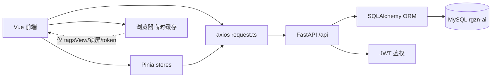

## 产品概述

将当前纯前端、依赖浏览器缓存的后台系统改造为前后端分离架构：新增 Python 后端连接真实 MySQL 数据库，把业务数据、登录权限、用户主题配置全部迁移到数据库；前端改为调用接口读写数据，并清理不再使用的模板演示页面和本地缓存代码。保留 tagsView、锁屏等纯界面临时状态在浏览器缓存中。

## 核心功能

- 业务数据入库：菜单、部门、角色、用户、减速顶、巡检、维修、巡检小车等数据全部由 MySQL 存储，支持增删改查与分页查询。
- 登录与权限接口化：后端校验账号密码，返回 JWT、用户信息、角色、按钮权限和可访问菜单；前端不再用随机数 token 或本地用户表判断权限。
- 主题配置持久化：主题、布局等偏好按用户保存到数据库，登录时加载，修改时回写。
- 初始化数据迁移：把现有 seedData 的初始数据一次性导入数据库，保证迁移后界面数据不丢失。
- 清理无用代码：删除纯模板演示页面、对应路由和 i18n key，删除被数据库替代的本地存储逻辑。
- 保留真实业务模块：保留首页、登录、个人中心、减速顶业务页面，以及当前已业务化的系统管理页面（用户、角色、部门、菜单）。

## 技术栈选择

- 后端：Python 3.10+、FastAPI、SQLAlchemy 2.x、aiomysql、pydantic-settings、python-jose（JWT）、passlib（密码哈希）、uvicorn。
- 数据库：MySQL，连接串由用户在服务端 `.env` 中配置，源码中不写死账号密码。
- 前端：沿用现有 Vue 3 + TypeScript + Vite + Element Plus + Pinia + vue-i18n + axios。
- 兼容现状：`src/utils/request.ts` 已有 `VITE_API_URL` 和 `Authorization` 请求头，可直接复用。

## 实现策略

采用“后端先行、前端逐步替换、最后清理”的顺序。先建数据库模型和 API，再让前端各 store 改为调用 API，最后删除演示页和本地缓存代码。

关键决策：

- 后端放在 `server/`，与前端同仓库但不混用依赖，避免影响现有前端构建。
- 数据库名 `rgzn-ai` 含连字符，SQLAlchemy 使用 `URL.create(user, password, host, port, database, query)` 构造连接，避免 URL 解析歧义。
- 菜单 `component` 虽然库中保留字段，但前端只按 path/name 映射到本地组件白名单，不执行后端返回字符串的动态导入，避免任意代码加载风险。
- 权限查询在登录接口中一次性联表返回角色、按钮权限和菜单路径，避免前端多次请求形成 N+1。
- 列表查询统一支持 page/pageSize 和关键字过滤，减速顶、巡检、维修等表在常用查询字段上建索引。
- 主题配置用 `user_settings.settings` JSON 字段保存，按用户隔离，结构变更无需频繁改表。

## 实施要点

- 不在源码中写入用户提供的数据库密码；新建 `server/.env.example`，真实 `server/.env` 本地保存并在 `.gitignore` 中忽略。
- 初始化脚本必须幂等：表不存在则创建，种子数据按主键或业务唯一键判断，重复启动不会重复插入。
- 统一响应结构 `{ code, message, data }`，前端 `request.ts` 现有 code 判断逻辑可继续沿用。
- `VITE_API_URL` 改为 `/api`，`vite.config.ts` 增加 `/api` 代理到 `http://127.0.0.1:8000`，生产环境改指向真实后端域名。
- 登录验证码暂保留前端校验；后端只校验 userName + password，避免本次改造范围无限扩大。
- 用户密码哈希后存储；seed 中 admin/test 设置初始密码并在文档中提示首次登录后修改。
- 删除文件前用 code-explorer 复核引用，禁止使用 `git checkout`、`git reset`、`git clean` 或任何会丢弃未提交改动的 git 命令。
- 用户此前多次撤销导致语言包回退，本次改动文件较多，实施时避免大范围 Ctrl+Z；每完成一个模块做一次编译校验。

## 架构设计



## 目录结构

```text
c:/Users/pan/vue-next-admin/
├── server/                                      # [NEW] FastAPI 后端根目录
│   ├── app/
│   │   ├── __init__.py                          # [NEW] 包标识
│   │   ├── main.py                              # [NEW] 应用入口，注册路由、CORS、异常处理、健康检查
│   │   ├── config.py                            # [NEW] pydantic-settings 读取 server/.env 中的 DB/JWT 配置
│   │   ├── database.py                          # [NEW] SQLAlchemy engine/session，使用 URL.create 构造 MySQL 连接
│   │   ├── models.py                            # [NEW] ORM 模型：菜单、部门、角色、用户、减速顶、巡检、维修、巡检小车、用户设置
│   │   ├── schemas.py                           # [NEW] pydantic 请求/响应模型，统一分页和 ApiResponse
│   │   ├── crud.py                              # [NEW] 通用增删改查与分页查询函数
│   │   ├── security.py                          # [NEW] 密码哈希、JWT 签发与解析、当前用户依赖
│   │   ├── seed.py                              # [NEW] 幂等导入 seedData 初始数据，建立用户-角色等关联
│   │   └── routers/
│   │       ├── __init__.py                      # [NEW] 路由包标识
│   │       ├── auth.py                          # [NEW] 登录、当前用户信息、退出接口
│   │       ├── settings.py                      # [NEW] 用户主题配置读写接口
│   │       └── resources.py                     # [NEW] 8 类业务数据 CRUD 接口，统一 /api/{resource}
│   ├── requirements.txt                         # [NEW] 后端依赖清单
│   ├── .env.example                             # [NEW] 环境变量模板，占位密码，不写真实密码
│   └── README.md                                # [NEW] 后端启动、建库、种子数据、接口说明
├── .gitignore                                   # [MODIFY] 忽略 server/.env、__pycache__、.venv
├── .env.development                             # [MODIFY] VITE_API_URL 改为 /api
├── vite.config.ts                               # [MODIFY] 增加 /api 代理到 http://127.0.0.1:8000
├── src/
│   ├── api/
│   │   ├── auth/index.ts                        # [NEW] 登录、获取当前用户、退出接口封装
│   │   ├── settings/index.ts                    # [NEW] 主题配置读写接口封装
│   │   └── resource/index.ts                    # [NEW] 通用业务数据 CRUD 封装，供各页面调用
│   ├── router/
│   │   ├── componentMap.ts                      # [NEW] path/name 到本地组件的白名单映射
│   │   ├── frontEnd.ts                          # [MODIFY] 菜单来源改为后端返回的菜单数据，移除 appData 依赖
│   │   ├── backEnd.ts                           # [MODIFY] 若不再使用后端控制路由模拟，改为统一走新 API
│   │   └── route.ts                             # [MODIFY] 删除演示页路由，保留首页、登录、错误页、个人中心、业务页
│   ├── stores/
│   │   ├── appData.ts                           # [DELETE] localStorage 本地数据库 store
│   │   ├── rbac.ts                              # [MODIFY] 改为基于后端返回的用户信息/角色/按钮权限，不再读 appData
│   │   ├── userInfo.ts                          # [MODIFY] 通过 /api/auth/me 获取用户信息，不再从 Session/Cookie 本地推导
│   │   └── themeConfig.ts                       # [MODIFY] 登录后加载用户主题配置，修改后防抖保存到数据库
│   ├── utils/
│   │   ├── seedData.ts                          # [DELETE] 初始数据迁移完成后删除；迁移脚本可临时读取其数据
│   │   ├── menuHelper.ts                        # [MODIFY] 使用 componentMap 白名单生成路由，不直接信任后端 component 字符串
│   │   ├── request.ts                           # [MODIFY] 保持 token 请求头，401 时调用清理逻辑，响应错误提示更明确
│   │   └── storage.ts                           # [MODIFY] 仅保留 token、tagsView、锁屏等临时状态封装
│   ├── views/
│   │   ├── login/component/account.vue          # [MODIFY] 登录改为调用 /api/auth/login，不再生成随机 token 或写 Cookie userName
│   │   ├── limits/                              # [DELETE] 模板权限演示页
│   │   ├── fun/                                 # [DELETE] 模板功能演示页
│   │   ├── make/                                # [DELETE] 模板组件封装演示页
│   │   ├── pages/                               # [DELETE] 模板页面演示页
│   │   ├── params/                              # [DELETE] 模板路由参数演示页
│   │   ├── visualizing/                         # [DELETE] 模板数据可视化演示页
│   │   ├── chart/                               # [DELETE] 模板图表演示页
│   │   ├── tools/                               # [DELETE] 模板工具演示页
│   │   ├── railway/                             # [MODIFY] 四个业务页改为调用 API，不再 useAppData
│   │   └── system/                              # [MODIFY] 用户、角色、部门、菜单管理改为调用 API；保留模块本身
│   └── i18n/lang/
│       ├── zh-cn.ts                             # [MODIFY] 删除演示页相关 key，保留业务和系统管理 key
│       ├── en.ts                                # [MODIFY] 同步删除演示页相关 key
│       └── zh-tw.ts                             # [MODIFY] 同步删除演示页相关 key
└── README.md                                    # [MODIFY] 增加前后端启动顺序和数据库初始化说明
```

## 关键代码结构

```typescript
interface ApiResponse<T> {
  code: number;
  message: string;
  data: T;
}

interface LoginResult {
  token: string;
  userName: string;
  roles: string[];
  authBtnList: string[];
  menuPaths: string[];
  userInfos: UserInfos;
}

interface ResourceQuery {
  page: number;
  pageSize: number;
  keyword?: string;
}
```

## Agent Extensions

### SubAgent

- **code-explorer**
- Purpose: 在实施前深度复核所有 Local/Session/appData/rbac 使用点，以及待删除演示页的路由、组件、i18n 依赖。
- Expected outcome: 产出精确的新增、修改、删除文件清单和引用关系，避免误删业务代码或遗漏缓存调用。