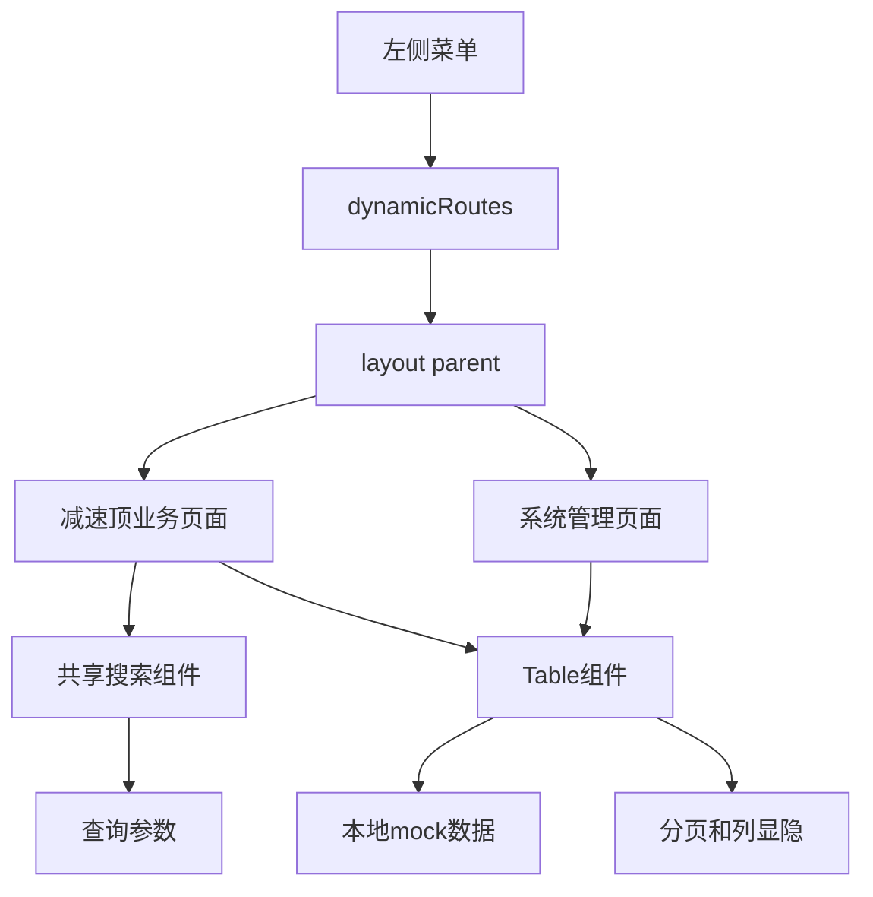

## 产品概述
按截图重构后台侧边菜单，并补齐减速顶相关业务页面和系统管理页面的字段、搜索区、按钮、表格列与本地数据展示。菜单管理页面保持原样。

## 核心 Features
- 侧边菜单调整为：首页；减速顶管理，包含减速顶信息、巡检作业、减速顶维修、巡检小车；系统管理，包含单位管理、角色管理、用户管理、菜单管理。
- 减速顶信息页提供编号和站段搜索、查询和新增设备按钮，表格展示设备编号、厂家、规格型号、安装地点、股道号、启用时间、报损时间、备注和操作。
- 巡检作业页提供编号、站段和检测时间区间搜索，查询和导出按钮，表格展示减速顶编号、安装高度、快压力值、慢压力值、回程时间、间隙宽度、正面图、测试时间、检测人员和操作。
- 减速顶维修页提供编号、维修项目和维修时间区间搜索，查询和新增按钮，表格展示减速顶编号、维修时间、维修项目、维修人员和操作。
- 巡检小车页提供编号、站段和检测时间区间搜索，表格展示帧头、减速顶编号、省市单位场股道区、顶型号、顶编号、压力值、回程时间、间隙宽度、正面图和测试时间。
- 单位管理页仅展示部门名称、部门简称、到期时间和操作；角色管理页展示新增角色按钮及序号、角色名称、数据范围、操作；用户管理页展示选择单位面板、用户搜索、新增用户按钮和用户表格。
- 所有业务列表支持本地模拟数据、分页、列显隐和空数据提示；按钮以界面展示和前端交互占位为主，不接入真实后端。


## Tech Stack Selection
- 沿用现有项目：Vue 3、TypeScript、Vite、Element Plus、Pinia、vue-i18n。
- 复用现有 `src/components/table/index.vue` 实现表格、分页、列显隐、导出和空数据提示。
- 不引入新的 npm 依赖；所有列表数据使用本地 mock 数据。
- 当前 `src/stores/themeConfig.ts` 中 `isRequestRoutes: false`，菜单由 `src/router/route.ts` 的 `dynamicRoutes` 控制。

## Implementation Approach
以前端静态路由和本地 mock 数据为基础，先重构 `dynamicRoutes` 只保留目标菜单，再新增四个减速顶业务页面，最后按截图改造三个系统管理页面。搜索区抽象为共享组件，表格继续复用现有 Table 组件并增加少量兼容扩展。

### 关键决策
- 使用绝对路径路由匹配截图：父级 `/data` 和 `/system`，子级 `/relarder`、`/detection`、`/maintain`、`/deldata`、`/dept`、`/role`、`/user`、`/menu`。
- 不修改 `src/views/system/menu/index.vue`，遵守用户“菜单管理不用变什么”的要求。
- 不复用 `src/views/make/tableDemo/search.vue` 作为业务组件，因为它位于演示目录且只支持单日期和固定查询和重置按钮；新增 `src/components/tableSearch/index.vue` 与现有 Table 组件形成统一基础能力。
- 扩展现有 Table 组件的配置项，默认行为保持不变，仅在显式开启时显示修改按钮，避免影响 tableDemo。
- 新增和新增设备等按钮提供前端提示占位，避免复用旧弹窗导致字段与目标页面不一致。

### Performance and Reliability
- 所有数据均为本地数组，查询复杂度为 O(n)，页面数据量小，无需虚拟列表。
- 列显隐由 Table 组件现有 `filter` 实现，避免重复渲染和重复计算。
- 日期区间使用 Element Plus 原生 `daterange`，不引入moment类依赖。
- 路由改造仅替换 `dynamicRoutes` 展示结构，原有页面文件保留，降低副作用。

## Implementation Notes
- 不要删除登录验证码和广告移除相关改动。
- 不要修改菜单管理页面代码。
- 保留首页路由和 tagsView 固定标签行为。
- 三语路由标题必须同步，避免出现 `message.router.xxx` 原始 key。
- 新页面使用 `EmptyObjectType` 和现有 `TableHeaderType`，必要时只做兼容扩展。
- 正面图列使用 Table 组件已有 `type: 'image'` 能力，图片加载失败时保持 Element Plus 默认占位效果。

## Architecture Design


## Directory Structure
```text
src/
├── router/
│   └── route.ts                         # [MODIFY] 替换 dynamicRoutes 为目标菜单；新增 /data 父级和四个减速顶子路由；系统管理子路由改为 /dept /role /user /menu。
├── i18n/lang/
│   ├── zh-cn.ts                         # [MODIFY] 新增减速顶管理及相关页面标题；系统设置改为系统管理；部门管理改为单位管理。
│   ├── en.ts                            # [MODIFY] 同步英文路由标题。
│   └── zh-tw.ts                         # [MODIFY] 同步繁体中文路由标题。
├── components/
│   ├── table/
│   │   └── index.vue                    # [MODIFY] 兼容新增 isEdit 配置，开启时显示修改按钮并抛出 editRow 事件；保留原删除行为。
│   └── tableSearch/
│       └── index.vue                    # [NEW] 共享搜索组件。支持 input、date、daterange、select，支持自定义查询和额外操作按钮。
├── types/
│   └── views.d.ts                       # [MODIFY] 扩展 TableSearchType，增加 daterange 占位和可选操作配置；新增业务表格状态类型。
└── views/
    ├── railway/
    │   ├── relarderIndex.vue            # [NEW] 减速顶信息页。编号和站段搜索，查询和新增设备按钮，设备字段表格，列显隐和分页。
    │   ├── detectionIndex.vue           # [NEW] 巡检作业页。编号、站段和检测时间搜索，查询和导出按钮，检测字段表格。
    │   ├── maintainIndex.vue            # [NEW] 减速顶维修页。编号、维修项目和维修时间搜索，查询和新增按钮，维修字段表格。
    │   └── deldatasIndex.vue            # [NEW] 巡检小车页。编号、站段和检测时间搜索，宽表格展示帧头和检测数据，支持横向滚动。
    └── system/
        ├── dept/index.vue               # [MODIFY] 改为单位管理字段：部门名称、部门简称、到期时间、操作；移除搜索和新增部门。
        ├── role/index.vue               # [MODIFY] 改为角色管理字段：序号、角色名称、数据范围、操作；保留新增角色按钮。
        └── user/index.vue               # [MODIFY] 增加选择单位左侧面板；右侧改为用户名称搜索、新增用户和目标列。
```

## Key Code Structures
```ts
declare type TableSearchType = {
	label: string;
	prop: string;
	placeholder: string;
	required: boolean;
	type: 'input' | 'date' | 'daterange' | 'select';
	startPlaceholder?: string;
	endPlaceholder?: string;
	options?: SelectOptionType[];
};
```

```ts
declare type BusinessTableState = {
	tableData: {
		data: EmptyObjectType[];
		header: TableHeaderType[];
		config: {
			total: number;
			loading: boolean;
			isBorder: boolean;
			isSerialNo: boolean;
			isSelection: boolean;
			isOperate: boolean;
			isEdit?: boolean;
		};
		search: TableSearchType[];
		param: EmptyObjectType;
	};
};
```


## 设计风格
采用企业后台管理风格，沿用项目现有左侧深色导航、顶部面包屑标签和白色内容卡片。整体保持紧凑、清晰、信息密度高，重点突出查询条件、操作按钮和表格数据。

## 页面与区块规划
### 屏幕一：全局菜单和布局
1. 左侧深色导航：首页、减速顶管理、系统管理两组父级菜单，当前项高亮。
2. 顶部标签栏：展示当前页面面包屑和已打开标签，支持切换和关闭。
3. 内容卡片：白色卡片承载搜索区和表格，统一 15px 内边距。
4. 底部工具区：分页器居左，列设置、刷新和导出等工具居右。

### 屏幕二：减速顶信息页
1. 搜索区：编号和站段输入，查询为主按钮，新增设备为绿色按钮。
2. 数据表格：序号固定，设备字段完整展示，文字列省略溢出。
3. 操作列：修改和删除文字按钮，保持轻量。
4. 空状态：暂无数据居中显示，分页固定在底部。

### 屏幕三：巡检作业页
1. 搜索区：编号、站段和检测时间区间，日期选择显示 Start date、To、End date。
2. 操作区：查询蓝色按钮和导出绿色按钮。
3. 数据表格：检测数值列和正面图列，列宽紧凑但可读。
4. 列设置：支持检测人员作为隐藏可选项，默认与截图一致。

### 屏幕四：减速顶维修页
1. 搜索区：编号、维修项目和维修时间区间横向排列。
2. 操作区：查询和新增按钮。
3. 数据表格：仅展示维修编号、时间、项目和人员。
4. 分页区：空数据时仍显示分页控件。

### 屏幕五：巡检小车页
1. 搜索区：编号、站段和检测时间区间。
2. 宽表格：帧头、位置和检测数据横向排列，支持横向滚动。
3. 图片列：正面图使用固定小尺寸占位。
4. 分页区：保持共条数、每页条数、页码和跳转。

### 屏幕六：系统管理页面
1. 单位管理：无搜索区，直接展示部门名称、简称、到期时间和操作。
2. 角色管理：顶部新增角色按钮，表格只保留序号、角色名称、数据范围和操作。
3. 用户管理：左侧选择单位面板，右侧用户搜索和新增用户。
4. 用户表格：序号、用户名、姓名、手机号、用户状态和操作。

## Agent Extensions
### SubAgent
- **code-explorer**
  - Purpose: 核对 `dynamicRoutes`、i18n key、业务页面和菜单管理页面之间的引用关系，识别遗漏文件。
  - Expected outcome: 输出需要同步修改的文件清单和确认菜单管理页面无需改动。

### Skill
- **playwright-cli**
  - Purpose: 在浏览器中
